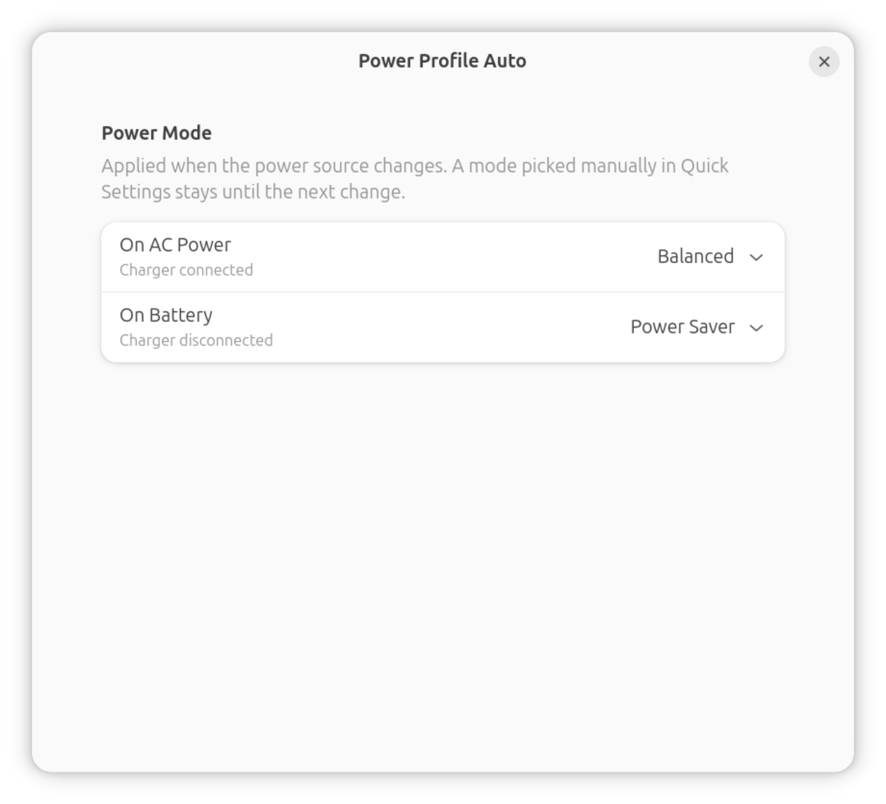

# Power Profile Auto

GNOME Shell extension that sets the power mode automatically when you plug in or unplug the
charger. Pick one mode for **AC power** and one for **battery** (Performance, Balanced or Power
Saver).



- Switches only when the power source changes (and when the extension starts). A mode you pick
  manually in Quick Settings stays until the next plug/unplug, it is not overwritten every time
  the battery level changes.
- Disabling the extension leaves the current mode alone.
- Keeps working on the lock screen.

Supports GNOME Shell 50 (Ubuntu 26.04) and 51 (Ubuntu 26.10). Needs `power-profiles-daemon`
(or another service providing `org.freedesktop.UPower.PowerProfiles`, such as `tuned-ppd`).

## Install

```sh
git clone https://github.com/chrisOTM/gnome-power-profile-auto.git
cd gnome-power-profile-auto
./install.sh
```

Log out and back in (Wayland), then choose the modes in Extensions → Power Profile Auto →
Settings, or with `gnome-extensions prefs power-profile-auto@chrisotm.github.io`.

## Credits and license

Based on [power-profile-switcher](https://github.com/eliapasquali/power-profile-switcher) by
Elia Pasquali. Licensed under GPL-3.0, see `LICENSE`.
